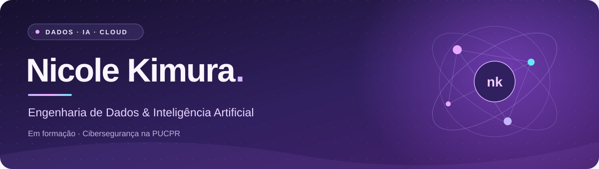

<div align="center">



<br />


</div>

<br />

## 🪻 Sobre mim

Sou a **Nicole**, estudante de **Cibersegurança na PUCPR**. Quero seguir na área de **engenharia de dados com inteligência artificial** e estou construindo essa trajetória com estudos e projetos pessoais.

Atualmente, estudo **Python no CS50P, de Harvard**, e **Cloud Computing na AWS**, com o objetivo de conquistar a certificação **AWS Certified Cloud Practitioner**. Também concluí um curso de **Power BI na Udemy**.

<br />

## 🧩 Tecnologias & ferramentas

<div align="center">

**No meu projeto**


<br />
<br />


<br />
<br />

**Nos meus estudos**


</div>

<br />

## 🚀 Projeto em destaque

<table>
<tr>
<td>

<h3>🎬 YouTube Resumidor</h3>


<p><strong>De uma URL a um resumo com IA.</strong></p>

<p>Extrai a transcrição de um vídeo do YouTube, gera um resumo em português com a API do Gemini e salva o resultado em um banco de dados SQLite.</p>

<p>Um projeto pessoal para praticar <strong>consumo de APIs, fluxo ETL e IA generativa aplicada</strong>.</p>

<p>


</p>

<a href="https://github.com/nicolekimura/youtube-etl-ia"></a>

</td>
</tr>
</table>

<br />

## 🎓 Formação & aprendizado

<table>
<tr>
<td width="50%" valign="top">

<h3>🛡️ Cibersegurança</h3>
<p><strong>PUCPR</strong></p>
<p>Graduação em andamento.</p>


</td>
<td width="50%" valign="top">

<h3>🐍 Python · CS50P</h3>
<p><strong>Harvard</strong></p>
<p>Introdução à Programação com Python.</p>


</td>
</tr>
<tr>
<td width="50%" valign="top">

<h3>📊 Power BI</h3>
<p><strong>Udemy</strong></p>
<p>Curso concluído.</p>


</td>
<td width="50%" valign="top">

<h3>☁️ Cloud Computing</h3>
<p><strong>AWS</strong></p>
<p>Estudos para a certificação Cloud Practitioner.</p>


</td>
</tr>
</table>

<br />

## 🎯 Objetivos atuais

```text
nicole@estudos:~$ cat minha-trajetoria.txt

  ✓  Concluir o curso de Power BI
  ↻  Cursar Cibersegurança na PUCPR
  ↻  Aprofundar Python com o CS50P
  ↻  Desenvolver o YouTube Resumidor
  ↻  Estudar Cloud Computing na AWS
  ○  Conquistar a certificação AWS Cloud Practitioner

  direção → Engenharia de Dados + Inteligência Artificial

nicole@estudos:~$ _
```

<div align="center">
  <sub>✓ concluído &nbsp; · &nbsp; ↻ em andamento &nbsp; · &nbsp; ○ objetivo</sub>
</div>
